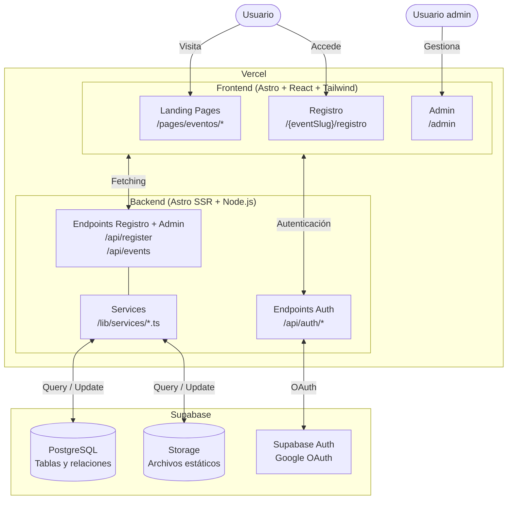

Este documento te guiará en el proceso de configuración, estructura del proyecto y mejores prácticas para contribuir a este repositorio.

---
## 📌 Tecnologías Utilizadas

El proyecto está construido con las siguientes tecnologías:

- **[Bun](https://bun.com/)** - Gestor de paquetes rápido y eficiente.
- **[Astro](https://astro.build/)** - Framework ligero para sitios estáticos y optimizados.
- **[Tailwind CSS](https://tailwindcss.com/)** - Framework de CSS orientado a clases utilizarias.
- **[shadcn/ui](https://ui.shadcn.com/)** - Biblioteca de componentes UI personalizables con Tailwind.
- **[Supabase](http://supabase.com/docs/reference/javascript)** - Backend como servicio para autenticación, base de datos y almacenamiento de archivos estáticos.
- **[Starlight](https://starlight.astro.build/)** - Framework de documentación escrito en Astro.
- **[Vercel](https://vercel.com/)** - Plataforma de despliegue y hosting.

## 🏛️ Arquitectura

Está divida en tres capas: Frontend, Backend y Supabase.



---

## 📁 Estructura del Proyecto

El repositorio se encuentra en [GitHub](https://github.com/jesulim/web-gdgsucre) y está organizado de la siguiente manera:

import { FileTree } from '@astrojs/starlight/components';

<FileTree>
- public/   Archivos estáticos públicos: favicon, og, etc.
- src
  - assets/   Archivos estáticos internos: Tipos de letra, imágenes
  - components    Componentes UI
    - events        Componentes específicos para eventos
      - io-extended-25
        - Hero.astro      Componente de un evento
    - ui/ Componentes base shadcn/ui
    - Header.astro    Componente global
  - layout    Estructura de las páginas
    - BaseLayout.astro
  - lib   Código compartido por componentes, páginas y endpoints
    - services/    Servicios para conectar a supabase
    - templates/   Plantillas de emails
    - validators/   Schemas de zod para validación de datos
  - pages   Páginas y Endpoints
    - api     Endpoints
      - register.ts
    - eventos
      - devfest-25.astro   Página de un evento
    - registro
      - [eventSlug].astro   Página de registro según el evento
    - index.astro Página principal
  - styles
    - global.css    Estilos globales, fuente, colores, etc.
- .env  Variables de entorno
- .gitignore
- README.md
</FileTree>


---

## 🛠️ Configuración Inicial

Para empezar a trabajar en el proyecto, sigue estos pasos:

### 1️⃣ Clona el Repositorio

```sh
git clone https://github.com/jesulim/web-gdgsucre
cd web-gdgsucre
```

### 2️⃣ Instala las Dependencias

Usamos **[Bun](https://bun.com/)** para manejar las dependencias:

```sh
bun install
```

### 3️⃣ Ejecuta el Proyecto en Local

Para correr la versión en desarrollo:

```sh
bun dev
```
### 4️⃣ Abre el proyecto en el navegador
El sitio estará disponible en `http://localhost:4321` 🎉

#### 📄 Si necesitas conectarte a Supabase
Solicita el archivo `.env` con las credenciales.

---

## 🚀 Despliegue

Cada rama se despliega automáticamente en **Vercel**.
- La rama `main` se despliega a www.gdgsucre.com
- Las demás ramas se despliegan a un subdominio de Vercel. Cuando subas tu Pull Request a GitHub, tendrás un comentario del bot Vercel con el link.

---

## 📢 Cómo contribuir

Si deseas contribuir al proyecto:

1. **Crea una nueva rama** siguiendo las [convenciones](/reference/branch).
2. **Confirma tus cambios y sube un Pull Request (PR)**.
3. **Solicita la revisión y aprobación** para hacer el merge a `main`.

---

## ❓ Preguntas Frecuentes

**No sé mucho sobre Astro, ¿puedo contribuir?** <br/>
Sí, el proyecto busca que cualquier persona pueda aprender y aportar. Puedes empezar con documentación, corrección de errores o mejora del código existente.

**¿Cómo puedo sugerir una nueva funcionalidad?** <br/>
Contacta al equipo o crea un **issue** en GitHub explicando tu idea.

---

🎉 ¡Gracias por tu interés en contribuir en la Web del GDG Sucre! 🚀
